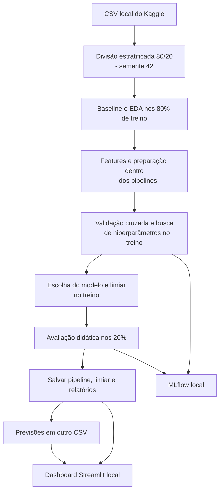

# Titanic — classificação de sobrevivência

Projeto **exclusivamente educacional** para praticar um fluxo de Machine Learning.
Usa dados históricos para estudar associações e previsão; não serve para decisões reais.

## Como rodar
Execute os comandos na raiz do repositório, em PowerShell.
Ambiente validado: Python 3.14.5 em Windows, sem GPU.

```powershell
py -3.14 -m venv .venv
.\.venv\Scripts\Activate.ps1
python -m pip install -r requirements.txt
```

Se a `.venv` já existir, apenas ative-a.
Caso a ativação esteja bloqueada, use `.\.venv\Scripts\python.exe` no lugar de `python`.

Baixe [train.csv do Titanic no Kaggle](https://www.kaggle.com/competitions/titanic/data)
(pode exigir login e aceite das regras) e coloque em `data/train.csv`.
Para prever passageiros sem rótulos, baixe também `test.csv` para `data/test.csv`.

```powershell
python -m src.train
python -m src.predict --input data/test.csv
python -m unittest discover -s tests -v
python -m jupyterlab # Opcional: abrir os notebooks pelo navegador em vez do VS Code.
```

Leia os notebooks na ordem: **01 baseline → 02 EDA → 03 modelos**.
O notebook 03 também executa o treinamento: rodá-lo depois do terminal repete
o experimento e atualiza os relatórios; as execuções anteriores permanecem no MLflow.
O baseline usa o CSV local e validação cruzada somente nos 80% de treino, com
preparação dentro dos pipelines; não consulta o teste nem salva o modelo final.
A EDA ainda tem interpretações
e conclusões em branco a serem preenchidas.

## Fluxo


Compara dummy, regressão logística, árvore e XGBoost em CPU.
Usa F1 dos sobreviventes como critério didático, com acurácia, precisão, recall
e ROC-AUC de apoio. Ajusta o limiar com previsões fora da partição de treino.
O teste já foi consultado na versão anterior do baseline: a avaliação **não é independente**.
A correção do baseline evita novas consultas ao teste durante o estudo inicial,
mas não apaga esse histórico. O F1 usado para escolher o limiar é uma medida
de seleção interna, não uma avaliação independente do limiar escolhido.
A seleção interna também pode ser otimista; não usamos validação cruzada aninhada.
Dados ausentes e passageiros da mesma família são outras limitações.

## Resultados e experimentos

- `src/`: funções compartilhadas de preparação, treinamento e previsão.
- `reports/`: comparações, métricas, gráficos, metadados e conclusões em cinco linhas.
- `models/titanic.joblib`: pipeline, limiar e colunas esperadas, ajustados só nos 80%.
- `predictions/previsoes.csv`: identificador, probabilidade e classe prevista.
- `mlflow.db` e `mlartifacts/`: histórico local de experimentos e artefatos.

Para consultar o MLflow, após treinar:

```powershell
python -m mlflow ui --backend-store-uri sqlite:///mlflow.db --host 127.0.0.1 --port 5000
```

Abra http://127.0.0.1:5000 e selecione `titanic-aprendizado`; encerre com Ctrl+C.
Na interface, use **Model training** para consultar as execuções dos classificadores.
As buscas registram parâmetros e métricas; a avaliação registra relatórios e modelo.
Os resultados de cada modelo são registrados depois que sua busca termina;
não há acompanhamento de cada rodada ao vivo. Novos treinamentos criam novas
execuções com os mesmos nomes, preservando as anteriores.
Dados, modelo, previsões e armazenamento do MLflow ficam fora do Git.
Treino ou previsão com CSV ausente ou colunas faltantes informa o problema no terminal.
O dashboard é local e educacional, sem deploy ou uso operacional.

## Dashboard

Após treinar e gerar as previsões, execute:

```powershell
python -m streamlit run streamlit_app.py
```

Abra o endereço local mostrado no terminal. O painel lê os relatórios e o CSV salvo,
permite filtrar passageiros e baixar previsões. Precisão, recall e acurácia vêm
do teste com respostas conhecidas; os filtros das previsões não recalculam métricas.

A seção **Entendendo o treinamento** mostra o fluxo do experimento, compara o F1
de treino e validação, explica a escolha do modelo e permite explorar configurações
e as cinco rodadas da melhor configuração. Usa os relatórios concluídos de `reports/`,
com a data de atualização do resumo; não acompanha o treino ao vivo nem lista o
histórico do MLflow. Após um novo treinamento, clique em **Atualizar dados**.

Os gráficos interativos do dashboard usam **Plotly Express**, incluindo as opções
**Ambos**, **Heatmap** e **Barras** na comparação do F1. Os gráficos estáticos
gerados pelo treinamento continuam usando Matplotlib.

O painel possui três visualizações: **Previsões**, **Avaliação** e
**Entendendo o treinamento**. A primeira filtra e exporta previsões; a segunda
mostra métricas e matriz de confusão; a terceira explica a seleção dos modelos.
`src/dashboard_data.py` lê e filtra as saídas, `src/training_view.py` organiza
o estudo do treinamento e `src/dashboard_charts.py` reúne as figuras de F1.

Na comparação atual, a regressão logística foi escolhida pelo F1 médio de
**validação** (0,766), maior que o do XGBoost (0,760). O F1 maior do XGBoost
no treino (0,898) não é o critério de seleção e sugere possível sobreajuste
quando comparado à sua validação. Os valores são uma fotografia dos relatórios
atuais e podem mudar após novos experimentos.

Se a página ainda mostrar o gráfico antigo sem o seletor de visualização,
encerre o Streamlit com Ctrl+C no terminal, execute novamente o comando acima
e recarregue a página.
