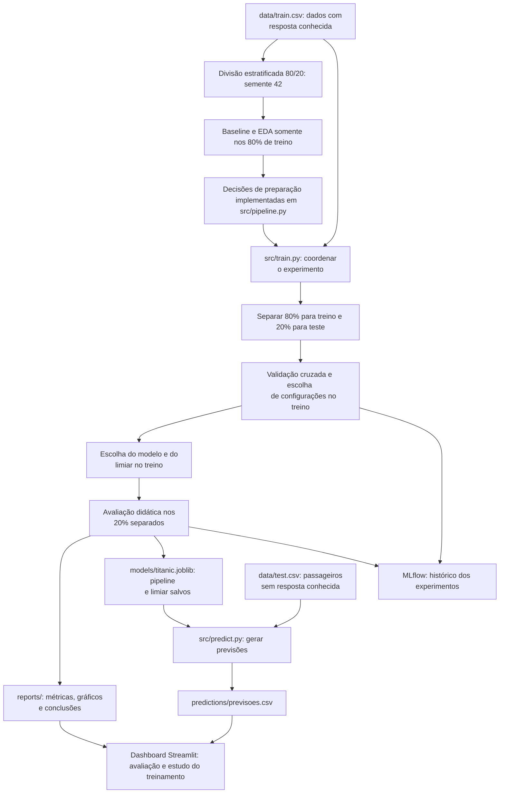

# Relatório de estudo — fluxo do projeto Titanic

Este documento reúne a explicação do funcionamento do projeto e as dúvidas discutidas durante o estudo.

O projeto é **exclusivamente educacional**, voltado à prática de Machine Learning. Seus resultados não devem ser usados em decisões reais. Os números apresentados são uma fotografia dos relatórios existentes quando este documento foi escrito; novas execuções atualizam os relatórios, mas não atualizam automaticamente este texto.

## 1. Qual é o objetivo do projeto?

Estudar se características dos passageiros do Titanic ajudam a prever a sobrevivência e comparar modelos com uma referência simples.

A coluna que queremos prever é o **target**, chamado `Survived`:

- `0`: não sobreviveu.
- `1`: sobreviveu.

As características de entrada são chamadas de **features**: idade, sexo, classe da passagem e variáveis criadas a partir dos dados, por exemplo.

O trabalho possui quatro etapas principais:

1. Entender os dados e formular hipóteses.
2. Preparar os dados, treinar, comparar e avaliar modelos.
3. Salvar o modelo e usá-lo para prever outros passageiros.
4. Explorar previsões, avaliação e comparação dos modelos no dashboard local.

## 2. Visão geral do fluxo



Baseline e EDA orientam o estudo, mas não precisam ser executados antes de cada treinamento. O script lê os dados e aplica suas próprias funções de preparação.

## 3. Ambiente, documentação e dados

### README.md

É a porta de entrada do repositório. Explica finalidade, instalação, execução, fluxo e limitações essenciais. Não executa o treinamento.

O [README](README.md) é curto; este relatório apresenta a explicação de estudo com mais detalhes.

### requirements.txt

Lista as bibliotecas e suas versões, como pandas, scikit-learn, XGBoost, MLflow,
JupyterLab, Streamlit e Plotly. O dashboard usa Plotly Express nos gráficos
interativos; o treinamento usa Matplotlib para salvar os gráficos estáticos.

```powershell
python -m pip install -r requirements.txt
```

Esse comando instala as bibliotecas no ambiente Python ativo.

### .venv/

Guarda o ambiente Python do projeto e suas bibliotecas. Quando `(.venv)` aparece no terminal, esse ambiente está ativado.

Ele ajuda a separar as dependências deste projeto das dependências de outros trabalhos. A pasta não contém a lógica do treinamento e não deve ser versionada.

### data/train.csv e data/test.csv

| Arquivo | Conteúdo e finalidade |
|---|---|
| `data/train.csv` | Passageiros com `Survived` conhecido; permite aprender e medir acertos e erros |
| `data/test.csv` | Passageiros sem `Survived`; permite gerar previsões, mas não calcular diretamente métricas locais sem respostas verdadeiras |

**O arquivo `test.csv` do Kaggle é diferente dos 20% de teste separados pelo projeto.** Esses 20% são retirados de `train.csv`, porque precisamos conhecer a resposta verdadeira para avaliar.

## 4. O papel dos notebooks

### notebooks/01_baseline.ipynb — referência inicial no treino

Esse notebook usa `data/train.csv` e as funções compartilhadas de `src/baseline.py` e `src/pipeline.py`:

1. Separa 80% para treino e reserva 20% para teste, com estratificação e semente 42.
2. Inspeciona apenas o treino.
3. Monta os pipelines compartilhados para Dummy e regressão logística.
4. Aprende a preparação dentro de cada rodada da validação cruzada.
5. Compara os modelos por validação cruzada de cinco partes nos 80% de treino.
6. Compara limiares usando previsões de validação cruzada somente no treino.
7. Não avalia o teste e não salva modelo nem relatórios finais.

O notebook não fornece um modelo salvo para o script atual e não precisa rodar antes dele.

A versão anterior preenchia idades antes da validação cruzada e comparava limiares no teste. A versão corrigida evita esses usos. O histórico de consulta ao teste permanece: corrigir o código não torna o conjunto novamente independente. As métricas usadas para escolher o limiar também são medidas de seleção interna, não uma avaliação independente do limiar escolhido.

### notebooks/02_eda.ipynb — análise exploratória

A EDA investiga a qualidade, as distribuições e as relações entre as variáveis:

- Valores ausentes, duplicatas e valores suspeitos.
- Proporção de sobreviventes.
- Distribuições de idade e tarifa.
- Relações de sexo, classe, idade e embarque com sobrevivência.
- Combinações entre características.
- Ideias de features e testes de hipóteses.

Sua principal entrega é **entendimento que orienta decisões**, e não apenas uma tabela alterada.

| Observação exploratória | Decisão incorporada ao fluxo |
|---|---|
| Há idades ausentes | Preencher com mediana |
| `Fare` possui muita assimetria | Criar `LogFare` |
| Nomes contêm títulos | Criar `Title` |
| Relações familiares podem ajudar | Criar `FamilySize` e `IsAlone` |
| Muitas cabines estão ausentes | Criar `HasCabin` |
| Sexo e classe se associam ao target | Incluí-los nas características dos modelos |

Essas decisões não garantem melhora: a modelagem avalia seu conjunto. Uma associação exploratória também não demonstra causalidade.

Os campos em branco da EDA permanecem para escrever interpretações.

### Por que a tabela preparada na EDA não é enviada ao treinamento?

As alterações feitas em um notebook ficam na memória daquela sessão, a menos que sejam salvas. O treinamento atual lê novamente o CSV original e aplica as transformações registradas em código.

É possível uma EDA salvar um arquivo preparado. Neste projeto, a escolha foi manter os dados originais e centralizar as transformações em funções reproduzíveis.

Isso também evita calcular antecipadamente estatísticas com dados que depois serão usados para validação. A mediana, por exemplo, deve ser aprendida apenas com o treino de cada rodada.

Assim, **o conhecimento da EDA chega ao treinamento pelas decisões implementadas no pipeline**.

### notebooks/03_modelos.ipynb — acompanhar o experimento

O notebook apresenta:

1. Ambiente e dados.
2. Features e preparação.
3. Treinamento e registro.
4. Comparação de modelos e discussão de overfitting.
5. Avaliação e interpretação.
6. Conclusões em cinco linhas.
7. Artefatos e previsão.

Ele importa e chama `run_training()`, definida em `src/train.py`, e depois mostra os relatórios gerados.

### Por que existem o notebook 03 e o script de treino?

| Entrada | Finalidade |
|---|---|
| `python -m src.train` | Executar o treinamento pelo terminal |
| Notebook 03 | Explicar o processo e apresentar resultados de forma interativa |

A lógica principal foi escrita uma vez. O notebook chama a mesma função usada pelo terminal.

Ter os dois não é obrigatório: um primeiro exercício poderia funcionar apenas com notebook. Essa organização permite praticar a passagem da exploração para um treinamento executável por comando.

**Escolha uma forma de treinar por vez.** Executar o script e depois a célula de treinamento do notebook repete o experimento, atualiza os relatórios e cria novos registros no MLflow.

## 5. src/pipeline.py — preparar os dados

Este módulo é compartilhado pelo treinamento e pela previsão.

### Constantes

- `ROOT`: identifica a raiz do projeto.
- `SEED = 42`: centraliza a semente de operações aleatórias.
- `RAW_FEATURES`: lista as colunas brutas usadas como entrada.
- `NUMERIC` e `CATEGORICAL`: separam as features criadas por tipo de preparação.

A lista explícita de features evita usar acidentalmente `Survived`, sua cópia textual `Desfecho` ou o identificador como informação preditiva.

### read_passengers()

Lê o CSV e verifica se:

- O arquivo existe e contém passageiros.
- As colunas obrigatórias estão presentes.
- `PassengerId` está preenchido e não se repete.
- As colunas numéricas verificadas contêm números ou ausências, sem negativos ou infinitos.
- No treinamento, `Survived` contém apenas 0 e 1, sem nulos.

Essa função verifica a estrutura necessária ao fluxo; ela não substitui toda a investigação da EDA.

### create_features()

Cria características usando informações da própria linha:

| Feature | Construção |
|---|---|
| `Title` | Extrai o título do nome, padroniza algumas formas e agrupa títulos raros |
| `FamilySize` | `SibSp + Parch + 1`, incluindo o próprio passageiro |
| `IsAlone` | Indica se `FamilySize == 1` |
| `HasCabin` | Indica se existe cabine registrada |
| `LogFare` | `log(1 + Fare)`, permitindo também tarifa zero |

O nome completo e o texto da cabine não chegam ao estimador: são usados para gerar título e indicador de cabine.

### build_pipeline()

Monta uma sequência de operações:

```text
Criar features → preencher ausências → codificar/padronizar → modelo
```

- Numéricas: preenchimento com mediana.
- Categóricas: preenchimento com moda e one-hot encoding.
- Regressão logística: também recebe padronização das numéricas.
- Categorias novas: o codificador aceita entradas desconhecidas sem interromper a previsão.

One-hot encoding representa categorias por colunas numéricas indicadoras. Padronização coloca as numéricas em escalas comparáveis.

No treinamento, as etapas aprendem as estatísticas necessárias. Na previsão, reutilizam essas estatísticas, sem calculá-las novamente com os novos passageiros.

## 6. src/train.py — coordenar o experimento

```powershell
python -m src.train
```

### main()

Lê os argumentos do terminal e chama `run_training()`. O argumento opcional `--data` permite informar outro CSV de treinamento.

### run_training(): ordem das operações

1. Ler e validar o CSV.
2. Separar 80% para treino e 20% para teste, com estratificação.
3. Separar `X`, as características, e `y`, a resposta.
4. Criar as pastas de saída e os metadados.
5. Configurar o MLflow local.
6. Configurar a validação cruzada e comparar modelos.
7. Escolher a melhor configuração de cada modelo e o vencedor.
8. Gerar probabilidades fora da partição para escolher o limiar no treino.
9. Avaliar o pipeline vencedor nos 20% separados.
10. Calcular importância por permutação e criar gráficos.
11. Salvar relatórios, conclusões e pacote do modelo.
12. Registrar a avaliação final no MLflow.

### Por que 80% para treino e 20% para teste?

É uma escolha prática, não uma regra obrigatória.

No CSV atual, com 891 passageiros:

- 712 ficam no treino.
- 179 ficam no teste.

A maior parte fica disponível para aprender. Uma parte é reservada para observar o desempenho em passageiros que ficaram fora do aprendizado do fluxo novo.

A estratificação mantém aproximadamente a proporção de sobreviventes nos dois grupos. Dentro dos 712 passageiros, a validação cruzada orienta as escolhas de configuração.

O teste já foi consultado no baseline. Por isso, os resultados são apresentados como uma avaliação didática em um conjunto previamente consultado. Trocar a semente não apagaria essa consulta anterior.

### O que é seed?

Seed significa **semente**. Ela controla operações aleatórias, como a divisão dos passageiros e o embaralhamento das partições.

```python
random_state=42
```

Com os mesmos dados, ordem, parâmetros e condições de execução, permite repetir essas operações.

O número 42 não melhora o modelo; poderia ser outro inteiro fixo. Sua finalidade é permitir reprodução e comparação. A semente, sozinha, não garante resultados idênticos entre todas as versões de bibliotecas e ambientes.

### model_specs(): modelos e hiperparâmetros

Define os modelos e as configurações experimentadas:

| Modelo | Configurações da busca |
|---|---|
| Dummy | Sempre prevê a classe mais frequente do treino |
| Regressão logística | `C`: 0,1; 1; 10 |
| Árvore | `max_depth`: 3; 5; sem limite; `min_samples_leaf`: 1; 5 |
| XGBoost | `max_depth`: 2; 3; `n_estimators`: 100; 200; `learning_rate=0.1` fixo |

Hiperparâmetros são escolhas feitas antes de ajustar um modelo. `max_depth` limita a profundidade das árvores; `n_estimators` define a quantidade de árvores do XGBoost; `C` controla a regularização da regressão logística.

### compare_models(): escolher as configurações

Usa `GridSearchCV` com validação cruzada estratificada de cinco partições:

1. Divide o treino em cinco partes.
2. Ajusta o pipeline com quatro partes.
3. Avalia na parte restante.
4. Repete até cada parte ter servido para avaliação.
5. Calcula a média e o desvio das métricas.

Isso é feito para as configurações de cada modelo. A preparação também é ajustada dentro de cada rodada, evitando aprender medianas, modas ou categorias com a parte usada na validação.

A métrica principal é F1 da classe sobrevivente. Também são registradas acurácia, precisão, recall e ROC-AUC.

A melhor configuração de cada família é a que tem maior F1 médio. Depois, comparamos essas configurações vencedoras. O dummy serve de referência e não disputa a seleção final.

Em empate numérico entre modelos reais, o código prefere regressão logística, depois árvore e depois XGBoost. A configuração vencedora de cada busca é reajustada nos 80% completos do treino.

### Por que existe um dummy no baseline e outro no script?

O dummy responde: **quanto conseguimos acertar com uma regra muito simples?**

No projeto, a classe majoritária é não sobrevivente. Sempre prever essa classe já produz uma acurácia considerável, mas F1 zero para sobreviventes, porque nenhum deles é identificado.

O dummy do notebook 01 ensinou esse conceito. O dummy do script recria a referência nas condições do experimento completo.

Não é necessário executar os dois. O baseline é uma introdução com validação somente no treino; o fluxo principal cria a própria referência e não depende de um objeto que ficou na memória de outro notebook.

### evaluate(): calcular métricas

Recebe as respostas verdadeiras, as probabilidades e um limiar:

- **Acurácia:** proporção de previsões corretas.
- **Precisão:** entre os classificados como sobreviventes, quantos realmente sobreviveram.
- **Recall:** entre os sobreviventes verdadeiros, quantos foram identificados.
- **F1:** combina precisão e recall pela média harmônica.
- **ROC-AUC:** avalia a ordenação produzida pelas probabilidades considerando diferentes pontos de corte.

F1 é o critério didático adotado, não uma regra universal. Em um problema real, a escolha dependeria do objetivo e do custo dos erros.

### O que é limiar e como choose_threshold() funciona?

O modelo produz uma probabilidade de sobrevivência. O limiar, ou threshold, converte essa probabilidade em classe:

```text
Probabilidade >= limiar → 1
Probabilidade < limiar  → 0
```

| Probabilidade | Limiar | Classe prevista |
|---|---|---|
| 0,48 | 0,50 | 0 — não sobreviveu |
| 0,48 | 0,45 | 1 — sobreviveu |

Diminuir o limiar classifica mais passageiros como sobreviventes. Isso pode aumentar o recall, mas também os falsos positivos.

O fluxo usa `cross_val_predict` para gerar probabilidades para passageiros que ficaram fora do treinamento de cada rodada. Depois, `choose_threshold()` experimenta pontos de 0,20 a 0,80, em passos de 0,05.

Escolhe o maior F1. Em empate, prefere o limiar mais próximo de 0,50 e depois o maior limiar.

Essa etapa é ajuste interno: a configuração do modelo já foi escolhida usando o treino. Não é uma avaliação independente, e o projeto não usa validação cruzada aninhada.

### save_plots() e experiment_metadata()

`save_plots()` gera os gráficos de comparação, limiares, matriz de confusão e importância.

A importância por permutação embaralha uma coluna e observa a redução do F1. No código atual, usa o teste e o limiar padrão 0,50 para interpretação posterior. Não orienta nova seleção de features ou reajustes. Variáveis correlacionadas podem compartilhar importância, e esses valores não demonstram causalidade.

`experiment_metadata()` registra semente, versões das bibliotecas, identificação do CSV por SHA256 e informações do Git. O fluxo também registra quais passageiros ficaram em treino e teste.

## 7. MLflow: finalidade e configuração

MLflow é um histórico organizado dos experimentos. Permite comparar configurações, métricas e arquivos de diferentes execuções.

### Como o código configura o registro

1. `mlflow.set_tracking_uri(...)` aponta para o SQLite local `mlflow.db`.
2. Procura o experimento `titanic-aprendizado`.
3. Se não existir, cria o experimento com armazenamento de arquivos em `mlartifacts/`.
4. `mlflow.set_experiment(...)` seleciona o experimento.
5. `mlflow.start_run(...)` inicia os registros de comparação e avaliação.

Dentro deles:

```python
mlflow.log_params(...)     # Configurações
mlflow.log_metrics(...)    # Resultados numéricos
mlflow.log_artifact(...)   # Arquivos
```

As execuções de cada família registram a melhor configuração, métricas e um CSV com a busca completa. A execução final registra métricas de teste, relatórios e pacote do modelo.

O registro de cada família ocorre depois que sua busca termina. A interface
permite consultar os resultados concluídos, mas o código não transmite o progresso
de cada configuração ou rodada em tempo real. Cada treinamento completo cria
quatro execuções de seleção e uma de avaliação final; nomes repetidos podem
corresponder a treinamentos realizados em momentos diferentes.

As métricas com prefixo `cv_` se referem à validação cruzada: `cv_accuracy` é a
acurácia média e `cv_accuracy_std` é o desvio padrão entre as cinco rodadas.
Por exemplo, 0,823 de média e 0,021 de desvio significam 82,3% de acertos em média
e desvio padrão de aproximadamente 2,1 pontos percentuais. O desvio não é outra
acurácia nem um intervalo de confiança. A mesma interpretação vale para `cv_f1`
e `cv_f1_std`.

### Arquivos do MLflow

- `mlflow.db`: banco com informações estruturadas dos experimentos.
- `mlartifacts/`: arquivos associados a cada execução.

Enquanto `reports/` é atualizado pelo treinamento mais recente, o MLflow mantém o histórico das execuções.

### Abrir a interface

```powershell
python -m mlflow ui --backend-store-uri sqlite:///mlflow.db --host 127.0.0.1 --port 5000
```

Acesse http://127.0.0.1:5000. A interface é local; o comando não publica o projeto nem treina modelos.

O código registra os resultados mesmo sem a interface aberta. Mantenha o terminal da interface aberto enquanto consulta e encerre com Ctrl+C.

### Onde encontrar os experimentos?

1. Clique em **Model training**, ao lado de **GenAI**.
2. Selecione **titanic-aprendizado**.
3. Abra `dummy`, `logistica`, `arvore` ou `xgboost` para consultar a validação.
4. Abra `avaliacao-final-didatica` para consultar os resultados no teste.
5. Consulte **Metrics**, **Parameters** e **Artifacts**.

A área GenAI/Traces não é onde este projeto registra o treinamento dos classificadores.

### O que significam as mensagens vistas no terminal?

| Mensagem | Significado neste projeto |
|---|---|
| `Registry store URI not provided` | O MLflow usa o banco configurado também para o registry |
| `localhost-only` | O acesso do servidor está restrito à máquina local |
| `job backend does not support Windows` | Uma função de execução de tarefas pelo servidor não está disponível; nosso treino roda diretamente no Python |
| `StarletteDeprecationWarning` | Uma dependência usa um componente marcado para substituição futura; o aviso observado não impediu a inicialização |
| `Application startup complete` | A inicialização do serviço foi concluída |
| Vários processos de servidor | São os processos usados para atender a interface |

## 8. Saídas do treinamento

### reports/

| Arquivo | Conteúdo |
|---|---|
| `busca_dummy.csv`, `busca_logistica.csv`, `busca_arvore.csv`, `busca_xgboost.csv` | Resultados das configurações de cada família |
| `comparacao_modelos.csv` | Comparação das melhores configurações |
| `limiares.csv` | Métricas para os limiares experimentados |
| `metricas.json` | Modelo escolhido, parâmetros, limiar e resultados de teste |
| `metadata.json` | Versões, semente, identificação dos dados e divisão |
| `validacao.png` | Comparação dos modelos e comportamento dos limiares |
| `matriz_confusao.png` | Acertos e erros por classe |
| `importancia.csv` e `importancia.png` | Importância por permutação |
| `conclusoes.md` | Cinco conclusões baseadas nos resultados medidos |

### models/titanic.joblib

Guarda um pacote com o pipeline treinado nos 80%, o limiar, as colunas esperadas, o nome do modelo e os metadados.

O pipeline inclui as estatísticas aprendidas para preparação e o estimador. Isso permite prever sem treinar novamente.

## 9. src/predict.py e predictions/previsoes.csv

```powershell
python -m src.predict --input data/test.csv
```

`main()` lê os argumentos e chama `predict_csv()`, que:

1. Carrega o pacote salvo.
2. Lê e verifica o CSV.
3. Confere as colunas esperadas.
4. Aplica o pipeline já treinado.
5. Calcula probabilidades.
6. Aplica o limiar salvo.
7. Grava o CSV de saída.

A saída padrão é `predictions/previsoes.csv`:

| Coluna | Significado |
|---|---|
| `PassengerId` | Identificação do passageiro |
| `ProbabilidadeSobrevivencia` | Probabilidade prevista pelo modelo |
| `Survived` | Classe obtida com o limiar salvo |

A previsão não reajusta o pipeline. Ela reutiliza as transformações e o modelo aprendidos no treinamento.

## 10. Testes automatizados e arquivos de apoio

### tests/test_workflow.py

Contém verificações do funcionamento do código:

- Construção das features e exclusão do target.
- Nulos e categorias desconhecidas.
- Mediana aprendida somente com a partição de treino.
- Preservação das previsões ao salvar e carregar o pipeline.
- Mensagens para arquivo, modelo ou colunas ausentes.
- Entradas inválidas.
- Reprodução da divisão e regras de desempate do limiar.

```powershell
python -m unittest discover -s tests -v
```

Atualmente, a suíte contém **15 testes**: oito em `test_workflow.py`, seis
em `test_dashboard.py` e um em `test_baseline.py`. O teste do baseline altera
as features dos 20% reservados e confirma que a comparação e o limiar não mudam.
Os resultados aparecem no terminal e não são registrados
no MLflow. Os testes do dashboard verificam filtros, navegação, relatórios ausentes
ou inválidos e a separação entre métricas de avaliação e o lote de previsões.

**Testes automatizados verificam o comportamento do código; métricas no conjunto de teste avaliam o desempenho preditivo.** Passar nos testes não garante boa previsão.

### src/__init__.py

Documenta e identifica o pacote Python `src`.

### .gitignore

Indica arquivos e pastas que não devem ser adicionados ao Git, como ambiente virtual, dados, modelos, previsões e armazenamento do MLflow.

Adicionar algo ao `.gitignore` não remove automaticamente um arquivo que já esteja versionado. Para parar de rastreá-lo mantendo a cópia local, usa-se `git rm --cached`; o histórico dos commits anteriores continua contendo o arquivo.

### tmp/ e pastas de cache

Guardam arquivos temporários de verificação ou arquivos produzidos automaticamente pelo Python e Jupyter. Não são entradas necessárias para executar o treinamento normal.

## 11. JupyterLab, VS Code e o servidor local

### O que faz python -m jupyterlab?

Abre um ambiente para editar e executar notebooks no navegador. Para isso, inicia um servidor local e mostra um endereço como `http://localhost:8888/lab?token=...`.

Esse comando não treina o modelo. O treinamento começa quando você executa a célula que chama `run_training()`.

### Por que foi incluído no README?

Como uma opção para abrir os arquivos `.ipynb`. Se você já usa notebooks pelo VS Code, não precisa abrir JupyterLab separadamente.

### O que significam as mensagens vistas?

- `successfully loaded`: componentes carregados.
- `Serving notebooks from local directory`: a interface está mostrando os arquivos da pasta informada.
- `running at ...`: endereço de acesso.
- `Skipped non-installed server(s)`: ferramentas opcionais de auxílio à edição não estão instaladas.
- Aviso de build sem Node.js: não impediu o uso normal observado dos notebooks.
- `jupyter_cookie_secret`: arquivo criado automaticamente pelo Jupyter para proteger a sessão; não é um arquivo do modelo de Machine Learning.

Mantenha o terminal aberto enquanto usa o JupyterLab e encerre com Ctrl+C, confirmando quando solicitado.

## 12. Resultados registrados nesta versão

Valores consultados em [comparacao_modelos.csv](reports/comparacao_modelos.csv) e [metricas.json](reports/metricas.json):

| Modelo | Melhor configuração | F1 médio no treino | F1 médio na validação | Desvio padrão do F1 na validação |
|---|---|---:|---:|---:|
| Dummy | Classe mais frequente | 0,000 | 0,000 | 0,000 |
| Regressão logística | `C=10` | 0,776 | 0,766 | 0,022 |
| Árvore | Profundidade 3; mínimo por folha 1 | 0,773 | 0,765 | 0,048 |
| XGBoost | Profundidade 3; 200 árvores | 0,898 | 0,760 | 0,029 |

A regressão logística venceu pelo maior F1 médio. As diferenças são pequenas e não demonstram superioridade geral desse algoritmo.

O critério considera o **F1 de validação**, e não o F1 de treino. O XGBoost teve
o maior F1 nas partes usadas para aprender (0,898), mas a vantagem desapareceu
nas partes de validação (0,760), um sinal de possível sobreajuste. As médias
de treino da tabela são calculadas nas partes de treinamento das cinco rodadas;
não são métricas dos 20% de teste final.

O limiar escolhido no treino foi **0,45**.

| Métrica no teste previamente consultado | Limiar 0,50 | Limiar 0,45 |
|---|---:|---:|
| Acurácia | 0,844 | 0,832 |
| Precisão | 0,806 | 0,775 |
| Recall | 0,783 | 0,797 |
| F1 | 0,794 | 0,786 |

Diminuir o limiar aumentou o recall, mas reduziu precisão e F1 nessa avaliação. Mantivemos 0,45 porque foi a escolha feita no treino; trocar após olhar o teste seria outro ajuste baseado nele.

O modelo é salvo sem um novo treinamento nos 100% dos dados.

## 13. Limitações e ordem sugerida de estudo

O teste foi consultado no baseline; a seleção interna também pode ser otimista, pois não há validação cruzada aninhada. A amostra é histórica e pequena, há dados ausentes e familiares podem compartilhar padrões. Nenhuma associação ou importância calculada demonstra causalidade.

Para estudar o código:

1. Leia o README para entender como executar.
2. Revise o baseline para compreender a referência simples.
3. Leia a EDA e preencha suas interpretações.
4. Estude `src/pipeline.py` para entender a preparação.
5. Acompanhe `run_training()` em `src/train.py` com o notebook 03 aberto.
6. Consulte os relatórios e o MLflow.
7. Leia `src/predict.py` para entender o uso do modelo salvo.
8. Leia os testes para entender os comportamentos que o código verifica.

Para executar o fluxo técnico, o CSV e as dependências instaladas são suficientes: não é necessário rodar os notebooks 01 e 02 antes do script.

## 14. Dashboard Streamlit: explorar as previsões

A interface local é iniciada com `python -m streamlit run streamlit_app.py`.

- `streamlit_app.py` organiza a tela, os cartões de precisão, recall e acurácia, os filtros, as tabelas e os gráficos.
- `src/dashboard_data.py` lê os relatórios e as previsões e aplica os filtros, sem treinar ou alterar o modelo.
- `src/training_view.py` apresenta a seção de estudo dos resultados do treinamento.
- `src/dashboard_charts.py` cria as figuras de F1 com Plotly Express, compartilhando a escala e os rótulos.
- `.streamlit/config.toml` define o tema visual.
- `tests/test_dashboard.py` verifica o comportamento da interface e a separação entre métricas e previsões.

As métricas são lidas de `reports/metricas.json`, calculadas nos passageiros de teste com resposta conhecida. A aba de avaliação compara o dummy, o limiar 0,50 e o limiar escolhido no treino e mostra a matriz de confusão.

As previsões vêm de `predictions/previsoes.csv`. Quando `data/test.csv` está disponível, o painel acrescenta nome, idade, sexo e classe pelo identificador do passageiro. É possível filtrar resultado previsto, probabilidade, nome ou ID e, quando disponíveis, classe e sexo, e baixar o recorte em CSV.

Os filtros alteram apenas o lote visualizado. Sem respostas verdadeiras nesse lote, não é possível calcular novas métricas. O dashboard não treina modelos, não altera o limiar e não substitui o histórico do MLflow. Após gerar novos arquivos, o botão Atualizar dados relê as saídas.

### Entendendo o treinamento

A terceira visualização explica o fluxo de preparação, validação cruzada,
escolha do modelo, ajuste do limiar e teste final. Usa os arquivos concluídos
de `reports/`, e não consulta o histórico do MLflow nem acompanha o treino ao vivo.
A data exibida é a atualização de `comparacao_modelos.csv`, no horário de Fortaleza;
ela não identifica de forma única uma execução do MLflow.

O seletor **Tipo de gráfico** oferece **Ambos**, **Heatmap** e **Barras**, com
ambos exibidos por padrão. As duas figuras mostram os mesmos valores de F1 médio
de treino e validação por modelo. O heatmap mantém cores na escala de 0 a 1 e
números nas células; as barras são agrupadas e mostram os valores sobre elas.

A tabela mostra a melhor configuração de cada modelo e o desvio padrão do F1
na validação. O painel destaca a maior diferença entre treino e validação como
um sinal de possível sobreajuste e explica o critério usado para escolher o vencedor.

No seletor **Modelo para estudar**, é possível consultar todas as configurações
avaliadas e as cinco rodadas da melhor configuração, inicialmente para o modelo
vencedor. Essas rodadas usam partes diferentes dos dados; não representam uma
sequência em que o desempenho deva melhorar. Nas colunas `test` dos CSVs de busca
do scikit-learn, o termo significa a validação interna, não o teste final de 20%.

Ao final, a seção apresenta a matriz de confusão do modelo vencedor com o limiar
escolhido e lembra que o conjunto de teste já foi consultado no baseline.
Todos os gráficos interativos do painel usam Plotly Express, inclusive a comparação
por rodada e as distribuições das previsões. Os PNGs produzidos pelo treinamento
continuam em Matplotlib.

Se a interface mostrar uma versão antiga, encerre o servidor com Ctrl+C no terminal,
execute novamente `python -m streamlit run streamlit_app.py` e recarregue a página.
O botão Atualizar dados relê relatórios; ele não substitui a reinicialização do
servidor quando alterações de código não foram carregadas.
